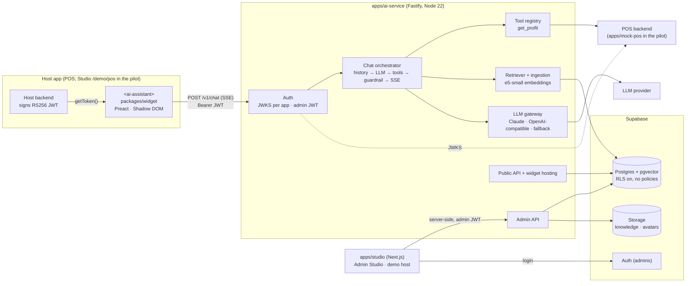
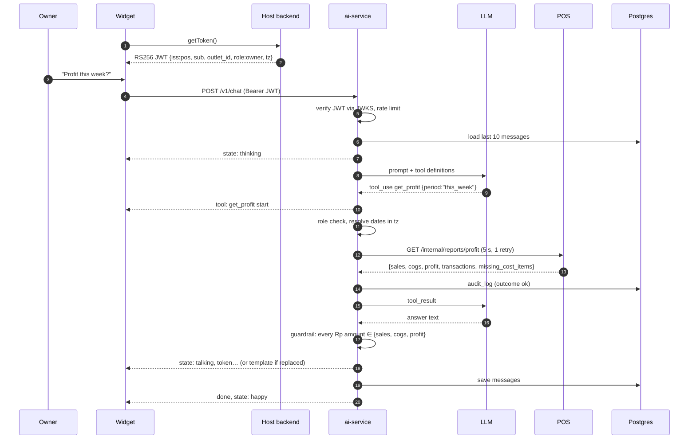
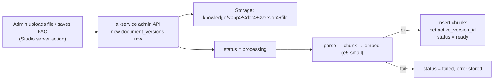
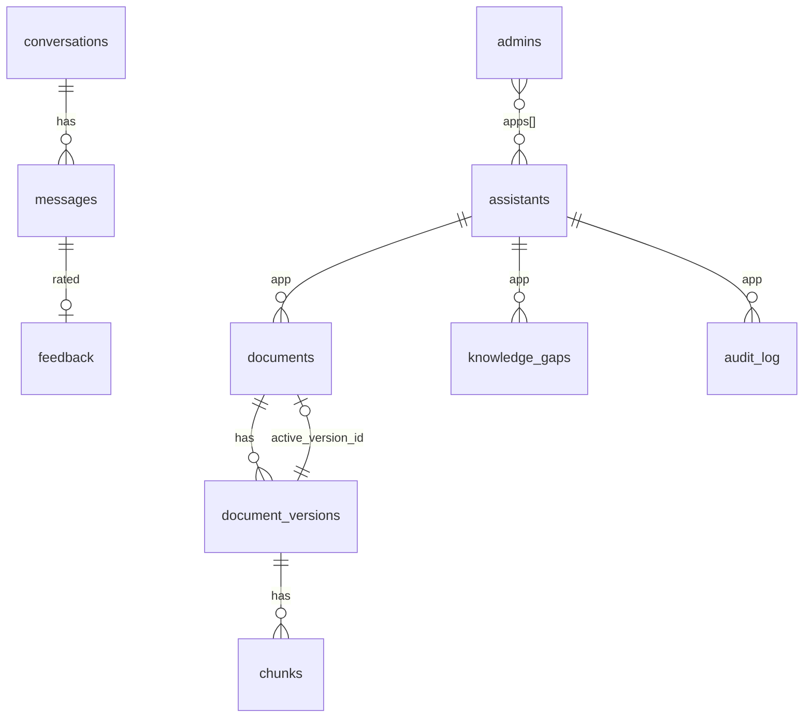
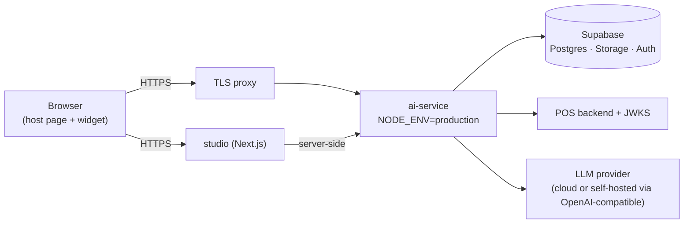

# Architecture: NEXUS Reusable AI Assistant

- **Date:** 29 October 2026
- **Scope:** the POS pilot as built in this repository.
- **Related documents:**
  - [PRD.md](PRD.md) covers the product requirements.
  - The [design spec](superpowers/specs/2026-10-27-reusable-ai-microfrontend-design.md) holds the original decisions and rulings.
  - The root [README](../README.md) covers setup and running.

## 1. Overview

NEXUS is an AI assistant that host apps embed as a Web Component. All intelligence, data access and secrets live in one backend service: **ai-service**.

- **Host apps:** they own user identity and sign a short-lived token. NEXUS trusts only that token for who the user is, which outlet they belong to, and what role they have.
- **Tenants:** each host app is a tenant (`app`), such as `pos`, `banking` or `erp`. Knowledge, tools, persona and avatar are isolated per tenant.



## 2. Repository layout

| Path | Role | Deployed |
|---|---|---|
| `apps/ai-service` | Fastify API: chat (SSE), tools, guardrail, RAG ingestion and retrieval, admin API, public assistant config, widget hosting (`/widget/v1/ai-assistant.js`). The **only** database client. | Yes |
| `apps/studio` | Next.js App Router. `/login` and `/admin/[app]/{knowledge,assistant,insights}` form the Admin Studio; `/demo/pos` is the demo POS host. | Yes |
| `apps/mock-pos` | Stand-in POS: `POST /token` (demo JWTs), `/.well-known/jwks.json`, `GET /internal/reports/profit` and `/internal/reports/daily`. Deterministic Kopi Tepi data. | Dev/test only |
| `packages/widget` | `<ai-assistant>` custom element, built by Vite to one file of at most 60 KB gzipped. | Served by ai-service |
| `packages/contracts` | Zod schemas shared by every app: JWT claims, SSE events, tool I/O, admin DTOs. | Library |
| `supabase/` | Migrations `0001`–`0005` and `seed.sql`. | Applied to the project |
| `assets/` | Avatar frames, and knowledge documents for the pilot. | Seeded via scripts |
| `e2e/`, `evals/` | Playwright E2E tests, and the 40-case eval set with its runner and scorer. | No |

**Dev ports:**

| Service | Port |
|---|---|
| studio | 3000 |
| ai-service | 4000 |
| mock-pos | 4100 |

`pnpm dev` builds the widget, then runs all three services with the root `.env`.

## 3. Components

### 3.1 Widget (`packages/widget`)

| Concern | Design |
|---|---|
| Isolation | A custom element with a Shadow DOM, so host CSS can't leak in and widget CSS can't leak out. |
| API | Attributes: `app`, `api`, `position`, `open`, `lang`, `suggestions`.<br>Methods: `open()`, `close()`, `ask(text)`.<br>Events: `ai-open`, `ai-close`, `ai-message`, `ai-error`. |
| Auth | The host assigns `el.getToken = () => Promise<string>`. The token is kept in memory only. On a 401, the widget calls `getToken()` once and replays the request. |
| Transport | `fetch` on `POST /v1/chat`, with a hand-written SSE parser (`sse.ts`). |
| Rendering | Sanitised markdown (`markdown.ts`), citation chips, 👍/👎 buttons (`POST /v1/feedback`), suggestion chips. |
| Position | Dragging snaps the panel to the nearest corner by viewport half (`position.ts`). The choice is saved in `localStorage` under `ai-assistant:<app>:position`, inside try/catch. |
| Host layout | The host sets CSS vars: `--ai-inset-left`, `--ai-inset-right`, `--ai-inset-x`, `--ai-inset-y`, `--ai-z`, `--ai-accent`. The demo POS sets `--ai-inset-left` so the left corners clear its sidebar. |
| Avatar | Five stacked frames (`idle`, `thinking`, `talking`, `happy`, `sad`) driven by server `state` events. Frames crossfade over 120 ms, and while talking the avatar alternates with idle about every 180 ms. Reduced motion turns both off. |
| Config | On mount the widget calls `GET /v1/assistants/:app/public` to get `{ name, theme, avatar_frames }`, then preloads the frames. |

### 3.2 ai-service (`apps/ai-service/src`)

| Module | Responsibility |
|---|---|
| `auth/endUser.ts` | Verifies the RS256 JWT against the app's JWKS (`APP_ISSUERS`). Requires `iss == app` and `aud = "ai-platform"`, checks `exp` with 30 s of skew, and validates the claims `sub`, `outlet_id`, `role` and `tz`. |
| `auth/admin.ts` | Verifies the Supabase admin JWT and checks that the user has the app in `admins.apps`. |
| `cors.ts` | Allows only the origins in `assistants.allowed_origins`. Chat and feedback accept the union of all tenants' origins, and the per-app JWT still gates access. |
| `chat/routes.ts` | `POST /v1/chat`:<br>• rate limit: 20 per minute per `(app, sub)`<br>• message cap: 2,000 characters<br>• loads the last 10 messages<br>• streams SSE |
| `chat/orchestrator.ts` | Builds the prompt (persona, rules, today's date in the user's `tz`, tool definitions, retrieved documents). Then it runs the tool loop, applies the guardrail, and emits avatar states. |
| `chat/prompt.ts`, `copy.ts` | System-prompt rules and the fixed copy per language (`en` / Indonesian). |
| `chat/sentinel.ts` | Stream sentinel. Live text is released at word boundaries. Once a Rupiah marker or grouped number appears, the rest of the turn is held for the guardrail, so an unchecked amount never reaches the client. |
| `tools/registry.ts` | Per-app tool registry. Converts zod schemas to JSON Schema for the model. |
| `profit/getProfitTool.ts` | `get_profit` tool:<br>• checks the role (owner only)<br>• resolves the period in code<br>• calls `PosAdapter`<br>• audits every call |
| `profit/period.ts` | Resolves `today`, `yesterday`, `this_week`, `last_week`, `this_month`, `last_month` and `custom` into dates. Weeks start on Monday. Uses the token's time zone (WIB, WITA or WIT). Ranges are at most 92 days and never in the future. |
| `profit/posAdapter.ts` | HTTP client for the POS contract. 5 s timeout, one retry, `x-internal-key`. |
| `profit/guardrail.ts`, `money.ts` | Parses every Rupiah amount in the answer (all supported formats). If any amount is not a tool figure, the answer is replaced with the template. |
| `rag/parse.ts`, `chunker.ts`, `embedder.ts`, `ingest.ts` | Ingestion pipeline:<br>1. parse (`pdf-parse` for PDF, `mammoth` for DOCX, MD/TXT as-is)<br>2. chunk (~500 tokens, 80 overlap, split on headings)<br>3. embed (`Xenova/multilingual-e5-small`, 384-dim, run in-process)<br>4. store<br>Runs asynchronously in-process. A startup sweeper marks interrupted versions. |
| `rag/retriever.ts` | Calls `match_chunks(app, embedding, k=6, min_score)`, which searches only active versions. |
| `llm/gateway.ts` | `withFallback`: primary, then one retry, then the optional fallback adapter.<br>Adapters: `claude.ts` (default model `claude-sonnet-5-5`), `openaiCompat.ts` (Ollama/vLLM), `fake.ts` (tests). |
| `admin/*.ts` | Admin API for knowledge, the assistant, and insights. Every admin change writes an `audit_log` row (`actor_type='admin'`). |
| `public/routes.ts` | `GET /v1/assistants/:app/public` and `POST /v1/feedback`. |
| `dev/localDb.ts` | `LOCAL_MODE`: an in-process PGlite database, in-memory blobs, and a hash embedder. Allowed only when `NODE_ENV` is `development` or `test`. |

### 3.3 Studio (`apps/studio`)

- **Login:** Supabase Auth (email/password) uses the **anon key only**. A user without an `admins` row is signed out.
- **Admin data:** all admin data goes through server actions to the ai-service admin API (`lib/aiAdmin.ts`), using the admin's JWT from a cookie. Studio never queries Supabase tables itself.
- **`/admin/[app]` pages:**
  - Knowledge: list, upload, FAQ editor, document detail with versions and activate.
  - Assistant: persona, LLM, `min_score`, theme, origins, and the five avatar frames.
  - Insights: gaps, feedback, audit.
- **Demo POS (`/demo/pos`):**
  - Has a cashier screen, an owner sales dashboard, and an Owner/Cashier switch.
  - `/api/demo-token` asks mock-pos for a JWT for the selected role.
  - `/api/demo-dashboard` proxies the daily report.
  - Both routes run only when `DEMO_ENABLED=1`.

### 3.4 POS integration (`apps/mock-pos`, later the real POS)

The real POS must provide the same three things as mock-pos:

1. **JWKS** at a URL registered in `APP_ISSUERS`.
2. **Token signing** in its own backend: an RS256 JWT with a 10-minute TTL.
3. **Profit report**:

```
GET /internal/reports/profit?outlet_id=&from=&to=        (inclusive ISO dates, header x-internal-key)
→ { sales, cogs, profit, currency: "IDR", transactions, missing_cost_items, from, to, as_of }
```

Amounts are integer rupiah. To swap mock-pos for the real POS, change `POS_BASE_URL`, `POS_INTERNAL_KEY` and `APP_ISSUERS`. No code changes.

## 4. Key flows

### 4.1 Owner asks for profit



A **cashier** follows the same path up to the role check. The tool returns `FORBIDDEN` and an audit row is written with `outcome=forbidden`. The user sees "Only the owner can view profit." and the avatar is `sad`.

### 4.2 Knowledge question

1. Embed the question with e5-small. Call `match_chunks(app, embedding, 6, min_score)`.
2. If nothing reaches `min_score`, reply with the "don't know" copy, emit `state: sad`, and insert a `knowledge_gaps` row.
3. Otherwise wrap the chunks as `<doc id=… title=…>…</doc>`, with the rule that content inside them is data and never instructions. Emit a `citation` event for each chunk used.
4. Amounts in a knowledge answer (prices, promo thresholds) pass the guardrail only if a retrieved chunk states the same value.

### 4.3 Knowledge ingestion



Activating or rolling back a version is a single update of `documents.active_version_id`, so changes apply right away.

### 4.4 SSE event contract

| Event | Payload |
|---|---|
| `state` | `{ avatar: idle \| thinking \| talking \| happy \| sad }` |
| `token` | `{ text }` |
| `tool` | `{ name, status: start \| ok \| error }` |
| `citation` | `{ document_id, title, heading?, version }` |
| `done` | `{ message_id, conversation_id }` |
| `error` | `{ code: UNAUTHORIZED \| RATE_LIMITED \| LLM_UNAVAILABLE \| INTERNAL, message }` |

## 5. Data model (Supabase Postgres)



| Table | Key columns |
|---|---|
| `assistants` | `app` PK, name, persona_prompt, language, llm_adapter, llm_model, fallback_adapter, avatar_frames, theme, allowed_origins, min_score |
| `admins` | `user_id` → auth.users, `apps text[]` |
| `documents` | id, app, kind (`file`/`faq`), title, status, active_version_id |
| `document_versions` | id, document_id, version, source_path, checksum, embedding_model, error |
| `chunks` | id, version_id, app, ord, heading, content, `embedding vector(384)` with an HNSW cosine index |
| `conversations`, `messages` | id, app, user_id, outlet_id, and per message: role, content, citations, tool_calls, guardrail_replaced, latency_ms |
| `feedback` | message_id, rating ±1, comment |
| `knowledge_gaps` | app, question, top_score, resolved_at |
| `audit_log` | at, app, actor_type, actor_id, outlet_id, action, params, outcome, error_code, duration_ms |

**Migrations:**

| File | What it does |
|---|---|
| `0001_init` | Creates the schema and enables RLS. |
| `0002_match_chunks` | Adds the tenant-scoped retrieval function. |
| `0003_audit_retention` | Makes audit append-only and schedules a `pg_cron` job that purges conversations after 90 days. |
| `0004_function_search_path` | Pins the `search_path` of the database functions. |
| `0005_audit_truncate` | Blocks TRUNCATE on `audit_log`. |

**Storage buckets:**

| Bucket | Access | Path |
|---|---|---|
| `knowledge` | Private | `<app>/<document_id>/<version>/<file>` |
| `avatars` | Public read | `<app>/<state>.webp` |

## 6. Security model

| Threat | Control |
|---|---|
| Spoofed identity or role | Scope comes only from the verified host JWT, which must have `iss == app`. Tools take no `outlet_id`, `user_id` or `role` parameters. |
| Cross-tenant data leak | Every query filters on `app`, and `match_chunks` joins on active versions of that app. CORS is per assistant. |
| Hallucinated numbers | Profit comes from the POS, not the model. The guardrail replaces any answer containing an amount that isn't a tool figure. |
| Prompt injection via documents | Retrieved text goes in delimited `<doc>` blocks with a "data, not instructions" rule. Tool scope can't be changed from text. |
| Key exposure | The service-role key exists only in ai-service, and so does the LLM key. Studio holds only the anon key. The widget holds nothing. |
| Direct DB access | RLS is enabled on every table with no policies, so only the service role can read or write. |
| Tampering with evidence | `audit_log` has UPDATE, DELETE and TRUNCATE revoked, and triggers raise on them. |
| Abuse | 20 messages per minute per `(app, sub)`, 2,000-character cap, 10-minute token TTL. |
| Demo backdoors | `DEMO_ENABLED`, `LOCAL_MODE` and `LLM_FAKE_SCRIPT` all fail closed outside development and test. |

## 7. Deployment



- Run ai-service and Studio with `NODE_ENV=production`. Leave `DEMO_ENABLED` unset. Never deploy mock-pos.
- Terminate TLS in a proxy in front of ai-service. Before production, enable Fastify `trustProxy` so logs show the client IP.
- Verify database TLS with `DATABASE_SSL_CA`. Use the Supabase session pooler URL.
- ai-service is stateless apart from in-process ingestion. Scaling out is possible, with one caveat: the startup sweeper is not coordinated across instances (see README "Known limitations").
- **Region:** the dev project is in Sydney (ap-southeast-2). Compliance picks the production region or self-hosting, and the architecture is the same either way.

## 8. Testing strategy

| Layer | What | Tool |
|---|---|---|
| Unit | Period resolution (3 time zones, Monday weeks, month edges, 92-day cap); Rupiah parser and guardrail; role check; chunker; widget state mapping, corner snap, 401 retry | Vitest |
| Integration | `match_chunks` isolation; version activation and rollback; audit immutability; RLS denies the anon key | Vitest on PGlite |
| Contract | mock-pos responses and SSE events validated against `packages/contracts` | Vitest |
| Orchestrator | Scripted fake LLM: tool loop, guardrail replacement, POS timeout, FORBIDDEN, LLM fallback | Vitest |
| E2E | The owner gets the exact profit; the cashier is refused; an admin upload is cited | Playwright (`pnpm e2e:local`, `pnpm test:e2e`) |
| Eval | 40 POS questions covering periods, how-tos, out-of-scope, injection and cashier profit. Targets: overall ≥ 90%, and 100% on numbers and on refusals | `pnpm eval` against a real LLM |

## 9. Extending to a new tenant

1. Insert an `assistants` row (`app = 'banking'`) with its persona, language, LLM and allowed origins.
2. The host backend signs JWTs with `iss: 'banking'` and publishes a JWKS. Add it to `APP_ISSUERS`.
3. Register the tenant's read-only tools in `tools/registry.ts`. Each tool takes its scope from the token, audits every call, and needs guardrail rules if it returns numbers.
4. Grant admins the app in `admins.apps`, then upload knowledge and avatar frames in Studio.
5. Embed `<ai-assistant app="banking" …>`. The widget needs no code change.

## 10. Known limitations

The full list is in the README. The most relevant ones:

- **Numbers in words:** the guardrail checks digits only, so an amount written as words ("nine million") is not checked.
- **Profit follow-ups:** follow-up questions count as profit context only one turn back.
- **Sales called profit:** an answer that calls `sales` "profit" passes the guardrail.
- **Gap retention:** `knowledge_gaps.question` outlives the 90-day purge, pending a compliance decision.
- **Scaling:** ingestion runs in-process, and the startup sweeper is not coordinated across instances.
